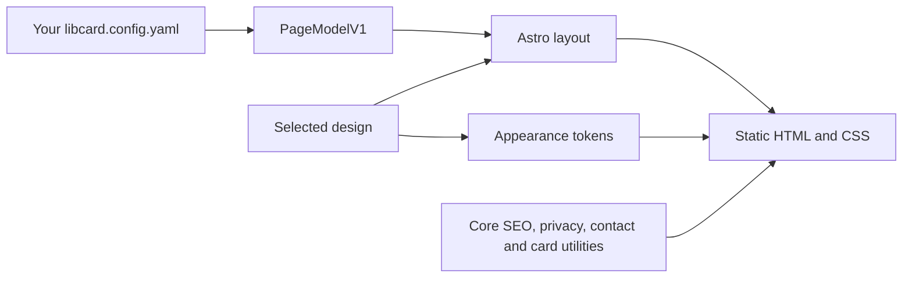

# Designs, layouts, and portable content

LibCard separates your content from its presentation. A **layout** arranges the
page, a **theme** supplies appearance tokens, and a **design** combines a layout,
an appearance, and presentation defaults. Switching designs never imports someone
else's profile, destinations, integrations, or analytics settings.



## Choose a design

```yaml
design: personal-home
```

`classic` preserves the original centered card with compact, label-only link
buttons. It omits link images, favicons, and editorial copy, and shows the profile
bio without a second intro when both are configured. The profile photo, social icons,
status badges, source links, and optional tip actions remain available.
`personal-home` selects Editorial,
Monochrome, compact spacing, and grayscale media. `studio` selects a profile
sidebar, image-led project gallery, coaching feature, and compact writing rows,
with a warm Studio theme supporting light and dark mode. Without new settings,
Classic and the default theme remain active. Browse `/designs` and `/themes` on your site,
or run `pnpm run design:list`.

Explicit owner settings win over design defaults:

```yaml
design: personal-home
theme: frost
layoutOptions:
  editorial:
    density: comfortable
    mediaTone: original
```

`layout:` can independently select `classic`, `editorial`, `studio`, or the ID of an
installed Astro layout. If you override a design with a different layout, its
layout defaults do not carry across. The chosen appearance remains independent.
Options are keyed by layout ID; a preset using Editorial uses `editorial` here.

### Studio options

```yaml
design: studio
theme:
  name: studio
  mode: system
  modeSwitcher: true
layoutOptions:
  studio:
    density: comfortable # Or compact
    mediaTone: original # Or grayscale; source images are unchanged
    masthead: independent work # An empty string hides this suffix
    collapseExperiments: true
```

These are Studio's default layout options. Set `collapseExperiments: false` to
honor each experiment section's own `collapsed` setting; untitled sections always
retain their original setting. Studio preserves your
section order, contact actions, social links, metadata, and rich blocks. A single
column replaces the sidebar and project grid on narrow screens. The Studio theme
also works with any other layout; `layout: studio` works with any theme.

With `footer.designGallery: true`, Studio is included in the random design/theme
action and has a direct preview at `/designs/try/studio/`. Gallery cards also link
to previews of their complete presets. Trying a preview never changes the owner's
configured home design.

## Install and update a shared design

Replace the example URL with an author's actual release repository:

```sh
pnpm run design:add -- https://github.com/AUTHOR/REPOSITORY --ref=v1.0.0
# Set design: author/notebook in libcard.config.yaml.
pnpm run design:check -- author/notebook
pnpm dev
pnpm build
```

Use a version tag matching the manifest version or a full 40-character commit.
Branches are rejected. A catalog's `--integrity=SHA256` additionally verifies the
expected package contents. Installation records both the resolved commit and a
hash of every declared file; future builds use the vendored files without fetching
the author's repository. Commit `designs/installed/` and `designs.lock.yaml` with
your card. HTTPS Git repositories and local directories/repositories are supported.

```sh
pnpm run design:update -- author/notebook --ref=v1.1.0
pnpm run design:rollback -- author/notebook
pnpm run design:fork -- author/notebook your-name/notebook
```

Updates are explicit. Without `--ref`, a Git update re-verifies its pinned commit;
it does not silently track a moving tag or discover a new release. A moved tag is
rejected when updating the same recorded tag. Rollback restores the previous
source and lock from `designs/history/`, without network access. Commit history
snapshots if you want rollback available in another checkout.

Edited installed files fail integrity verification and cannot be overwritten by
an update or rollback. Fork preserves those edits under a new local ID and keeps
the original license/credits. Then restore the installed files from Git before
building; do not manually change integrity hashes to conceal edits. To uninstall,
first select another design, remove that package's installed directory and lock
entry, and remove any obsolete options/appearance references.

**Trust model:** installing and inspecting metadata does not execute package code.
Building, running `pnpm dev`, or running a full design check executes the selected
Astro layout with your build's privileges. Opting into `footer.designGallery`
also builds the installed layouts for visitor previews. Review executable packages as source
code. Data-only presets and appearance YAML stay validated data. This format
accepts no package dependencies, install scripts, symlinks, submodules, hidden
files, or paths outside a package. It is not a sandbox for malicious source code.

## Author a layout or preset

```sh
pnpm run design:new -- your-name/notebook
# Or start with a core layout wrapper:
pnpm run design:new -- your-name/folio --from=editorial
# Or share appearance/options without any executable layout:
pnpm run design:new -- your-name/quiet --from=preset
```

The default scaffold is a responsive two-column notebook. `--from=classic`,
`--from=editorial`, and `--from=studio` wrap the corresponding core layout; expand or replace their
markup as needed. Files live in `designs/local/AUTHOR/NAME/`, which engine updates
preserve. `sample.config.yaml` contains generic example content, never a copy of
your card. Preview it with:

```sh
LIBCARD_CONFIG=designs/local/your-name/notebook/sample.config.yaml pnpm dev
```

A complete [reference package](../src/lib/fixtures/designs/notebook/README.md)
includes its own layout, appearance, SVG, options, and sanitized preview PNGs.
Try it with `pnpm run design:add -- ./src/lib/fixtures/designs/notebook`, then
select `design: example/notebook`. Its author/source URLs are placeholders; it is
a local example, not a published community release.

A complete manifest for a custom layout:

```yaml
schemaVersion: 1
id: your-name/notebook
name: Notebook
version: 1.0.0
description: A quiet two-column personal site.
author: Your name
authorUrl: https://example.com
source: https://github.com/AUTHOR/REPOSITORY
license: MIT
compatibility:
  layoutApi: 1
  astro: ">=5.13.0 <6"
  libcard: ">=0.2.0 <1"
layout:
  entry: ./Home.astro
  optionsSchema: ./options.schema.json
appearance:
  use: monochrome
defaults:
  width: wide
capabilities:
  blockFallback: core
  clientJavaScript: false
  remoteAssets: false
files:
  - Home.astro
  - options.schema.json
  - sample.config.yaml
  - README.md
  - LICENSE
```

`files` lists exact relative filenames, including assets. `design.yaml` is included
automatically. Unlisted files are rejected (except Git metadata); this makes the
export boundary reviewable. Packages are limited to 501 total files and 25 MiB.
`README.md` and `LICENSE` are required. The generated editor schema is
`designs/design.schema.json` (`pnpm run design:schema`).

Bundled appearance files use the same theme schema as built-ins, including
optional light/dark `schemes`. Their colors work with `theme.mode` and
`theme.modeSwitcher`. Built-in layouts place the light/dark icon toggle in the
header; custom layout authors receive it through the existing utilities slot.
See [theme color schemes](../themes/README.md#light-and-dark-appearances).

For a data-only preset, use `layout: { use: editorial }`, `classic`, or `studio` and omit the
Astro entry. Presets cannot override content. Arbitrary dependencies, nested
presets, custom block types, multi-page routing, and visitor-side layout switching
are outside API 1.

## Layout API 1

Import from `@libcard/layout`. Do not import engine internals. The entry receives
`{ page, options }` and a required named `utilities` slot:

```astro
---
import { Profile, ProfileActions, HeaderAction, Section, SocialRow, CardReveal, type LayoutProps } from "@libcard/layout";
type Props = LayoutProps;
const { page, options } = Astro.props;
---
<div class="my-layout" data-width={options.width}>
  <main id="main-content">
    <HeaderAction action={page.headerAction} />
    <Profile profile={page.profile} />
    <ProfileActions actions={page.actions} />
    {page.sections.map((section, index) => <Section section={section} index={index} />)}
    <SocialRow socials={page.socials} />
    <CardReveal url={page.card.url} />
  </main>
  <slot name="utilities" />
</div>
```

`PageModelV1` is frozen at runtime. Its fields are:

| Field | Contents |
|---|---|
| `apiVersion` | Literal `1` |
| `profile` | Name, optional role, tagline, location, intro, resolved avatar URL, optional resolved `give` action |
| `actions` | Deduplicated, available contact/card actions with label, href, icon, optional download |
| `headerAction` | Optional masthead action: label, resolved href, optional icon, native-handler-aware newTab; null when absent |
| `links` | Canonical inventory, resolved media URLs, and `presentation` metadata |
| `sections` | Ordered link groups with resolved links, or existing block types; root block placeholders expanded |
| `socials` | Social destinations, names, and optional resolved tip actions |
| `card` | Absolute page URL, card route, contact download, enabled flag |
| `site` | URL and base path |
| `legacy`, `firstRun` | Compatibility and setup state |

Optional link `headline`, `note`, and `actionLabel` provide a display headline,
supporting detail, and visible invitation without changing the canonical label
or destination. Preserve them when rendering richer content. `EditorialLink`
accepts `purpose` (`work`, `services`, `writing`, `experiments`, or `general`);
`Section` passes it automatically. Services with images use square portraits;
services without images use resource callouts. Work previews sit below their
copy and above a source footer.

Link `presentation` includes external-link attributes, status, GitHub companion
and counts, and Feedme tip metadata. Layouts must retain required destinations,
metadata actions, ordering, and collapsed content. Rich presentations retain
descriptions and other editorial copy; compact presentations can show only the
canonical label and omit link media. Use the core
primitives to get those details without reimplementing integrations.

Exports: `Profile`, `ProfileActions`, `HeaderAction`, `SocialRow`, `Section`, `Block`, `Link`,
`EditorialLink`, `Icon`, `CardReveal`, `Classic`, `Editorial`, `Studio`, `renderMarkdown`,
`withBase`, `absoluteUrl`, and model types. `Section` accepts optional
`layout="editorial"`, `"studio"`, or `"classic"`; Classic sections use compact
buttons. `<Link compact />` renders label-only links with metadata actions and no
images; `<Profile compact />` prefers the bio over a duplicate intro. `Block` is the standard fallback for every
existing block type and owns the integration handling those blocks need.
This includes `disclosure` groups (`title`, `open`, and a non-nested `blocks`
list). Delegate these to `Block` or `Section` to retain their native disclosure,
all child blocks, and integration behavior. Editorial renders social profiles as
text links and gives supplemental blocks the same compact treatment as its archive.
Editorial's full styling comes with the `Editorial` wrapper; a fully custom layout
styles its own rich links. Core primitives accept the model values above. Their
internal config fallback remains available for engine utility pages.

Render one `main#main-content` and one `h1`. Put all primary content inside main.
Render `utilities` **once, outside main**, in normal document flow. It preserves
credits, disclosures, the appearance switcher, and the landscape card overlay.
The core document owns the head, theme boot, analytics, background effects, and
corner action. Do not return another `html`, `head`, or `body` element. `/card`, QR,
vCard, and OG generation remain engine routes.
Production builds verify the main anchor and utilities placement automatically.

## Options, appearance, assets, and credits

Options use local JSON Schema draft-07. The root must be an object with
`additionalProperties: false`. Defaults must satisfy the schema; owner overrides
are shallow and are validated without coercion, injected defaults, remote schema
fetching, or custom validation code. Dormant option groups are validated too.

```json
{
  "type": "object",
  "additionalProperties": false,
  "properties": { "width": { "type": "string", "enum": ["wide", "narrow"] } }
}
```

Use `appearance: { file: ./appearance.yaml }` to bundle a theme. It follows the
existing [theme format](../themes/README.md), including its own author, license,
and optional `sourceUrl`. Appearance and design credits stay independent. With a
bundled appearance, `theme: your-name/notebook` also works independently, including
in switcher pools. Its CSS selector uses a deterministic hash to avoid collisions.
`footer.designCredit: false` hides permissively licensed design credits; required
attribution remains, just as it does for `footer.themeCredit`.

Import bundled assets with Astro/Vite, for example
`import mark from "./assets/mark.svg?url"`, then ``.
Imported URLs get the correct deploy base and hashed filenames. List the asset in
`files`; never copy package decorations into the owner's `public/`. Page-model
image URLs already include the base, so don't prefix them a second time. Use
scoped component CSS, the `--lc-*` tokens, and system font stacks. Capabilities
describe the package's added scripts/network behavior; they do not suppress
integrations an owner enabled in their content.

## Verify, publish, and discover

```sh
pnpm run design:check -- your-name/notebook --metadata-only
pnpm run design:check -- your-name/notebook
pnpm exec playwright install chromium
pnpm run design:preview -- your-name/notebook
```

Metadata checks are read-only and never import package code. Full checks build
rich, sparse, legacy, and all-block fixtures, checking content coverage, link
order, utilities placement, image alt attributes, and base paths. Preview adds
no-JS browser checks at 320, 390, 768, and 1280px, plus PNGs under
`.libcard/checks/AUTHOR/NAME/`. Review those images for spacing, contrast, and
content quality; passing automated checks is not a claim of complete accessibility.
The checks also cover a 200%-equivalent viewport, visible keyboard focus, failed
remote images, contact downloads, manual card navigation, and touch landscape mode.
Preview assets are generated neutral SVGs; the owner's `public/` is not copied.

Copy the desktop/mobile PNGs into your package and list them in `files`, then add:

```yaml
previews:
  desktop: previews/desktop.png
  mobile: previews/mobile.png
```

Set the real repository `source`, confirm licenses for every asset, and export:

```sh
pnpm run design:export -- your-name/notebook ./output/notebook-release
cd output/notebook-release
git init
git add .
git commit -m "feat: publish notebook design"
git tag v1.0.0
# Add your own repository remote, then push the commit and tag.
```

Only declared design-owned files are exported. The author is responsible for
ensuring their explicitly included sample content and screenshots are shareable.
The scaffold/checker use generic fixtures rather than the current owner's config.
Publish the exported directory as the root of its own repository; do not add
package.json or install hooks. A new release changes the manifest version and tag.

Optionally generate a catalog entry with
`pnpm run design:catalog -- your-name/notebook ./output/notebook.json` and submit it
to the `designs` array in `designs/catalog.json`. The index contains metadata,
compatibility, expected integrity, release reference, and preview paths. `/designs`
shows the local index and installed designs; browsing it does not fetch or execute
community packages. Direct URL installation works without a catalog listing.
The index starts empty rather than advertising nonexistent community releases.

The **Design conformance and previews** Actions workflow runs executable previews
in an unprivileged job with no deployment secrets and non-persisted checkout
credentials. Maintainers can dispatch it with a repository, pinned ref, and ID;
PRs touching local designs run it in the pull-request context. It uploads image
artifacts only. Never add executable designs to the separate privileged
`pull_request_target` theme-preview workflow.

`pnpm run test:designs` reproduces a complete local release/adoption round trip in
an isolated site: export, Git tag, pinned install, asset/credit checks, inactive
code isolation, update, edited-source fork, offline rollback, live dev selection
changes, and the shared Studio wrapper's light/dark control. Install its browser
first with `pnpm exec playwright install chromium`. It neither publishes remotely
nor modifies your card.

## Ownership and upgrades

```text
designs/local/       owner-authored layouts and presets
designs/installed/   verified vendored releases
designs/history/     local rollback snapshots
designs.lock.yaml    pinned sources, versions, integrity, history
.libcard/           generated selection, metadata, and test previews (ignored)
```

`pnpm run update` preserves the design directories and lock. Before writing it
checks target engine/API compatibility with installed/local manifests and verifies
installed integrity. Normal dependency installation/build checks the resolved
Astro version again. Older engines lacking the API compatibility marker cannot
be adopted while packages are installed. Package upgrades are separate from
engine updates. See [UPGRADING.md](./UPGRADING.md).
