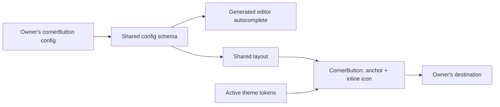
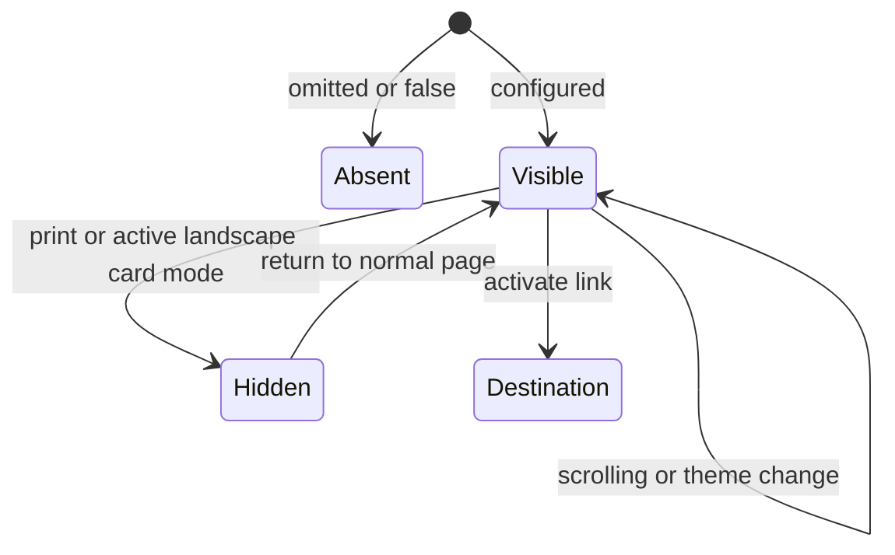

# Corner action button

## 🎯 Problem and summary

Visitors should be able to support Chris's work without finding the tip section
at the end of a long page. Add one optional, persistent corner link to LibCard.
The personal configuration uses **♡ Support my work → https://crs.tips** in the
top-right corner. Every owner can choose their own purpose and corner; the
reusable feature defaults to bottom-right.

## Current state

- `src/layouts/Layout.astro` wraps the home page, manual business card, and theme
  gallery. It is the shared mounting point for a site-wide action.
- `src/lib/schema.mjs` validates config and generates editor autocomplete. An
  omitted field must preserve existing cards; engine upgrades preserve YAML.
- `Icon.astro` already supplies heart, mail, calendar, and other inline icons.
- Theme tokens supply surface, foreground, accent, and border colors. The recent
  scroll-rendering exploration removed expensive glass backdrop filters.
- Landscape card mode covers the viewport at z-index 50 and removes covered
  content from keyboard navigation. The corner action needs the same treatment
  only when that overlay is actually enabled.
- Feedme is optional. A generic corner link must work independently of it.



## External research

[W3C's focus guidance](https://www.w3.org/WAI/WCAG22/Understanding/focus-not-obscured-minimum/)
explains why persistent UI must not hide the currently focused control.
[Its scroll-padding technique](https://www.w3.org/WAI/WCAG22/Techniques/css/C43)
provides a CSS approach; combine it with page padding at the occupied edge so
the last or first content can scroll clear of the button. Browser verification
is still needed, especially at narrow widths and with longer labels.

[MDN's environment-variable reference](https://developer.mozilla.org/en-US/docs/Web/CSS/Reference/Values/env)
documents safe-area insets. Add these to the corner offsets to accommodate
notches and home indicators. These are browser-provided values, not guessed
device dimensions.

## Key findings and alternatives

| Option | Benefit | Tradeoff |
| --- | --- | --- |
| Icon-only circle | Smallest footprint | A heart alone does not explain the action |
| Text pill with optional icon | Clear purpose, small footprint | Needs deliberate mobile spacing |
| Full-width fixed support bar | Easy to discover | Dominates the page and suggests a special support feature |
| Expandable widget | Room for descriptions or multiple actions | Adds JavaScript, focus management, and unnecessary interaction |

## Recommendation

Use a compact pill with the same theme palette, border, text, and icon colors as
the other link buttons. For glass themes, blend the surface over the theme's
background color to make an opaque tint. Unlike in-flow glass buttons, a fixed
action overlaps scrolling content; transparency lets unrelated text show through.
Keep a light border and soft shadow, with no backdrop filter.
Keep the label visible on phones. Use a heart for this site; do not build a
payment-provider dependency into the component. Avoid backdrop blur, pulsing,
popovers, scroll listeners, and icon-only mobile states.

The API is `cornerButton: false | { label, url, icon?, position?, newTab? }`.
Omission or `false` disables it. Position defaults to `bottom-right`, with all
four physical corners available. Navigation stays in the current tab unless
`newTab: true`; new-tab links carry a screen-reader notice and `noopener`.
Web, mail, phone, SMS, fragment, and site-relative links are supported. Reject
script/data schemes and protocol-relative URLs. Site-relative URLs honor the
GitHub Pages base path. Labels are trimmed, required, and limited to 48 characters.

```yaml
cornerButton:
  label: Support my work
  url: https://crs.tips
  icon: heart
  position: top-right # default: bottom-right; all four corners work
```

Mount once in the shared layout, reserve breathing room at the chosen edge, and
apply scroll padding. Keep a minimum 44px tap target and a visible focus ring.
Hide during printing and active landscape card mode; the button returns in
portrait. When card mode is disabled (or on the wide gallery), keep the regular
page and its corner button usable in landscape too.



## Compatibility and migration

No dependencies or client JavaScript are needed. Old configs keep their current
behavior. Add the feature to the engine, regenerate the schema, and opt in only
in this owner's YAML. Document the option in the README, upgrade guide, and
changelog. Fresh setup instructions must remove the demo corner link so another
owner never accidentally publishes Chris's support destination.

An older engine ignores unknown top-level fields, so update before opting in.
This feature does not create a widget stack or a new theme API. Custom themes
remain responsible for their token contrast, as with the existing buttons.

## Implementation checklist

- [x] Inspect shared layout, schema, themes, setup, and upgrade boundaries.
- [x] Add optional config with safe destinations and four-corner positioning.
- [x] Add a zero-JavaScript component using existing icon and theme tokens.
- [x] Integrate spacing, focus, print, and enabled-only card-mode behavior.
- [x] Enable the personal support link and update owner-facing documentation.
- [x] Regenerate the JSON schema through the existing build tooling.

## Validation checklist

- [x] Verify omitted/disabled configs, defaults, supported URLs, and rejections.
- [x] Run tests, Astro typecheck, and production build.
- [x] Browser-check Frost and Dawn, desktop and mobile, and scrolling.
- [x] Check all four corners, long labels, keyboard focus, and no-JS navigation.
- [x] Check print, card-mode landscape, disabled card mode, and the theme gallery.
- [x] Build a project-base fixture and a disabled fixture without changing owner content.

## Validation results

`pnpm test`, `pnpm typecheck`, and `pnpm build` pass. Astro reports no errors,
warnings, or hints. Schema checks cover opt-out behavior, defaults, four corners,
valid destinations, and invalid fields or URL schemes.

Chrome checks cover 320px, 390px, and 1100px layouts, Frost and Dawn, fixed
position while scrolling, print suppression, no-JavaScript navigation, and all
four corners. Project-base and disabled fixtures build successfully without
modifying the owner's config. A 45-character label wraps at 320px and remains
usable with 200% text sizing. New-tab navigation preserves the base path, query,
and fragment. Keyboard passes traverse 71 controls with no fully obscured focus
in the tested bottom-right and top-left configurations. Landscape checks cover
the enabled card overlay, disabled card mode, the theme gallery, and manual card.

The final personal configuration uses **top-right**. Final browser checks confirm
an opaque theme tint, no backdrop filter, clearance above the profile, and stable
position while scrolling at all three widths. Border, text, and icon colors use
the same tokens as ordinary links. Built-in glass themes retain their palette
without allowing underlying links to show through the floating action.

Browser scripts and captures are local artifacts under `output/playwright/`
with `check-corner-*` and `corner-final-*` names. Mobile checks use desktop Chrome
emulation; physical iOS/Android and nonzero device safe-area insets were not tested.
The feature is committed locally; publication is separate.
