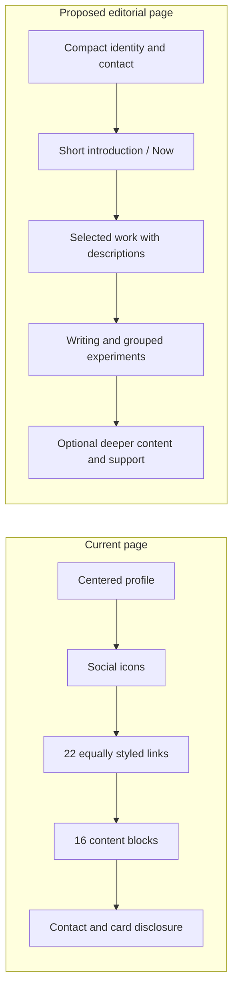
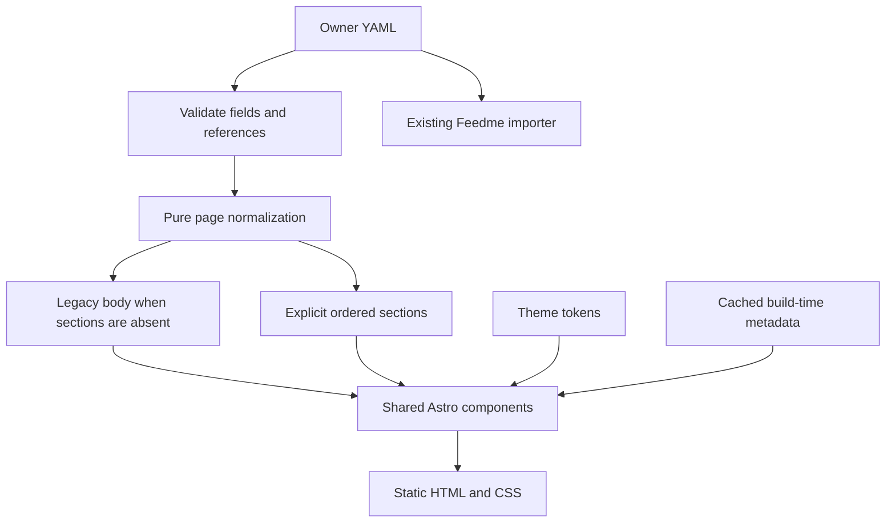

# A quieter personal home, inspired by kamran.fyi

## 🎯 Problem and executive summary

LibCard can become easier to understand and more useful by giving content a
clear hierarchy. The highest-value change is an optional **editorial layout**:
a compact introduction, a few selected projects with descriptions, grouped
secondary links, and contact actions within easy reach.

Keep the current card layout available. Preserve the owner's voice, pastel
themes, static build, QR/vCard features, and single-config publishing model.
The improvement should be reproducible by every owner through configuration.

**Recommended first release:** an editorial preset, optional link descriptions,
ordered sections referencing the existing link inventory, and discoverable
contact actions. Defer new block families, animation systems, and a page builder.

This is a research and design proposal dated **2026-10-19**, not an implemented
redesign. The accompanying conversational sketches use proposed copy and a
selection of existing destinations. They do not modify the owner's site.

## Current state in the repository

Read the latest exploration,
[0013: corner action button](./0013_[x]_CORNER_ACTION_BUTTON.md), before this
analysis. That feature solves a real discoverability problem: support is
available while scrolling. Keep it configurable and respect that recent choice;
do not remove it as a side effect of visual simplification.

| Evidence | Current behavior | Design implication |
| --- | --- | --- |
| [Owner config](../../libcard.config.yaml) | 22 links, 7 socials, 16 blocks, 15 GitHub companions; 21 links have statuses | Many destinations compete at the same visual level |
| [Home page](../../src/pages/index.astro) | `Profile → SocialRow → links → blocks → CardReveal` | Introductory prose and headings cannot precede or divide the main links |
| [Layout](../../src/layouts/Layout.astro) | Ordinary pages use `max-w-md`, 16px side padding, centered children, and a common 24px main gap | Desktop reading width and section rhythm are constrained |
| [Profile](../../src/components/Profile.astro) | 96px avatar, centered name/tagline/location | Pleasant card identity, but a relatively tall introduction |
| [LinkButton](../../src/components/LinkButton.astro) | Centered, truncated labels; filled bordered surface; shadow/lift; overlaid status; separate source pill | Labels carry both name and explanation; source pills reduce their available width |
| [TextBlock](../../src/components/blocks/TextBlock.astro) / [Heading](../../src/components/blocks/Heading.astro) | Centered prose and headings; text blocks use small muted text | Longer personal writing receives less readable treatment than navigation |
| [SocialRow](../../src/components/SocialRow.astro) | Icon-only circular links, accessible labels, 44px targets | Good target sizes; visible platform names would improve recognition |
| [CardReveal](../../src/components/CardReveal.astro) | QR, Save contact, and full-screen card are inside a disclosure after all blocks | A defining product capability is hard to find during a quick visit |
| [Schema](../../src/lib/schema.mjs) | Strict nested link objects; no descriptions, presentation sections, or editorial layout | These are engine capabilities to add, not YAML options that already exist |

The deployed [crs.land](https://crs.land/) was inspected in a desktop browser and
matches this broad structure. Its theme can vary because randomization is enabled.
The review observed label truncation even on desktop. It did not measure traffic,
conversion, or Core Web Vitals. Narrow-viewport screenshot output was unreliable,
so it is not evidence of a completed mobile audit.

Some older documentation and comments say blocks appear between links and
socials. The current home-page source places socials **before** links. Correct
that wording when documenting the new layout.



## External research

### What the reference demonstrates

On [kamran.fyi](https://kamran.fyi/), observed on 2026-10-19:

- A small portrait sits beside the identity; introductory prose leads into a
  current-work section.
- The reading column is narrow and left aligned. The desktop content area
  measured approximately 512px inside a 560px outer container.
- Projects combine names and short descriptions. Some receive cards and metrics;
  others use compact rows. Writing has dates, and experiments have their own group.
- Social destinations are named. Small headings, subdued separators, and larger
  gaps between groups establish rhythm.
- Additional career details can be revealed, and contact appears again at the end.

**Interpretation:** clarity comes from explaining destinations and allocating
attention deliberately. A monochrome palette alone would not produce that result.
The reference still contains many links and cards; minimalism is not merely a
small item count. These observations establish a design direction, not evidence
that its conversion rate or accessibility is better.

### Standards that constrain a cleaner design

- [WCAG contrast guidance](https://www.w3.org/WAI/WCAG22/Understanding/contrast-minimum.html):
  normal text needs at least 4.5:1 contrast, with 3:1 for qualifying large text.
  Muted descriptions are still content. Verify actual theme/background combinations.
- [WCAG target-size guidance](https://www.w3.org/WAI/WCAG22/Understanding/target-size-minimum.html):
  the AA criterion generally uses 24×24 CSS pixels or sufficient spacing, with
  exceptions. LibCard should retain approximately 44px touch targets as a product
  choice. Less visible chrome does not require smaller interactive areas.
- [Native details/summary](https://developer.mozilla.org/en-US/docs/Web/HTML/Reference/Elements/details)
  provides disclosure without custom client JavaScript. Use it for optional
  archives or supporting detail; keep primary projects and contact visible.

## Key findings

### 1. Explain before asking visitors to choose

The existing tagline conveys personality, but the page immediately asks visitors
to interpret many unrelated names. Add a short, left-aligned introduction or
"Now" section before the links. It should answer what the owner makes, cares
about, or wants to connect around. This is ordinary text content, not a dedicated
live-status integration.

For Chris, a possible edit is: "I make personal software and run experiments in
how we live, learn, and connect." Treat this as draft copy, not an approved
replacement for the current voice. Keep warmth, curiosity, and the breadth of
interests; avoid turning the page into a generic professional résumé.

### 2. Separate a destination's name from its explanation

`Feed Me Fund (open-source creator tips)` currently has to fit inside a single
truncated label. An optional description lets the title be short and the reason
to click remain readable. Allow title wrapping and natural description wrapping.
Do not substitute ellipsis or hover tooltips for essential meaning on a phone.

A project row can contain a title, one sentence, an optional status, and a quiet
"Source" link. Keep source and destination as sibling anchors; never nest a
GitHub link inside a clickable card. Counts can remain opt-in build-time data.
Never fabricate adoption numbers to imitate a mature project's credibility.

### 3. Give the page a reading order

Use a small number of owner-defined sections. Suggested arrangement for this
card, to review before editing content:

1. Identity, short introduction, and direct contact.
2. Selected work: perhaps xNet, LibCard, and Feedme, each with a description.
3. Work together: coaching and relevant resources.
4. Writing: the two essays, with dates only when known.
5. Experiments and explorations: compact rows, optionally with further items in
   a labeled disclosure. Preserve every destination.
6. A concise personal note, support, and an optional make-your-own invitation.

Selection and ordering are editorial decisions, not automatic sorting by GitHub
stars or inferred importance. The ideal count depends on the owner's purpose.
For this prototype, start with three featured projects and compare comprehension.

### 4. Establish three levels of emphasis

- **Primary action:** one clear invitation suited to the owner, such as contact
  or booking. The existing persistent support button may remain enabled.
- **Selected work:** descriptive rows or a small number of subtle cards.
- **Supporting links:** restrained text rows and compact metadata.

Move statuses into the normal text flow in the editorial variant. Review whether
each badge earns its space: a section already titled Writing often makes a
Writing badge redundant. Preserve explicit owner choices; do not silently strip
statuses or source links during upgrades.

### 5. Tighten rhythm while protecting readability

Prototype an outer width around 36rem with comfortable side padding, a 48–56px
portrait, 16px body copy, roughly 1.6 line height, and 36–48px section spacing.
Use smaller gaps inside groups. These are starting points to validate, not a
pixel-for-pixel copy or a rule for every theme.

The page can retain Frost or Dawn. Test the new hierarchy on a quiet solid
background first, then with the existing pastel wash. Prefer a stable chosen
theme for a consistent identity; keep the randomizer available as an explicit
owner preference. No new font dependency is required for the first iteration.

### 6. Make LibCard's useful differences easier to reach

Offer configurable Email / Save contact / Show card actions near the profile.
Reuse the existing `SaveContact` component and `/card` route. Keep large QR images
inside the existing disclosure or full-screen card so they do not dominate reading.
Do not force visitors to scroll through the project archive to save a contact.

Keep ownership, static hosting, theme portability, and graceful no-JS behavior.
Do not copy the reference's WebGL experiments, career popovers, testimonials, or
recognition blocks merely to make the feature checklist longer.

## Options and tradeoffs

| Option | Benefit | Limit / cost | Decision |
| --- | --- | --- | --- |
| Choose Paper/Mono and shorten labels | Immediate visual restraint; no engine change | Same fixed ordering, no descriptions or link grouping | Useful baseline, insufficient by itself |
| Editorial preset plus ordered sections | Solves hierarchy and preserves current cards | Schema, renderer, documentation, and integration checks | Recommended |
| Replace the default layout globally | One visual system | Unexpected changes to existing personal sites | Avoid in a minor upgrade |
| Arbitrary layout builder / many bespoke blocks | Maximum composition freedom | Larger API, more combinations, harder setup and upgrades | Defer |

## Recommendation and architecture

### Keep structure separate from theme

An editorial **layout** controls alignment, width, rhythm, and row treatments.
Themes keep controlling colors, font families, radius, and existing effects.
Selecting a different theme must not reorder content. Preserve the classic
layout when the new setting is omitted.

Use shared identity, link data, contact actions, and integrations. Avoid a second
custom home page for the maintainer. The
[landing-page constraint](./0008_[x]_LANDING_PAGE_AND_VIRAL_LOOP.md) still applies:
one owner config, one build, and features available to all owners.

### Preserve one canonical link inventory

Keep `links` as the source of destinations and Feedme metadata. Add optional
stable link IDs and descriptions; sections reference IDs rather than copying
URLs or using fragile labels/array positions. Existing block variants can be
reused within an optional ordered `sections` list, alongside a link-group variant.
Do not introduce recursive columns or arbitrary embedded markup.

Suggested normalization rules:

- Without `sections`, render the existing links-then-blocks body unchanged.
- With `sections`, render that explicitly ordered body. Require top-level
  `blocks` to be empty so existing content cannot silently disappear; give a
  migration message explaining where to move those blocks.
- Require every inventory link to be referenced exactly once, including any
  collapsed archive group. Reject missing, duplicate, and unknown references.
- Require unique stable IDs for links used by sections; IDs remain optional for
  legacy cards. Do not reuse or change Feedme IDs to satisfy layout concerns.
- Keep the normalization a pure function. Fetch metadata through the existing
  cached integrations before rendering, never through new browser requests.



**Integration gate:** [Feedme](../FEEDME.md) imports the raw YAML link inventory.
This repo's documentation establishes that contract, but does not establish
whether its deployed importer tolerates proposed `id` and `description` fields.
Verify against the importer before shipping or migrating the owner's config.
Do not move links into nested section items and assume Feedme will find them.

### Example config — proposed, not supported today

This deliberately small sketch illustrates the boundary. It is not a complete
config and must not be pasted into the current engine. Field names need review
during implementation; avoid exposing every CSS choice as another option.

```yaml
layout: editorial
profileActions: [email, save-contact] # proposed opt-in actions

links:
  - id: libcard
    label: LibCard
    description: A little home on the internet that you own.
    url: https://crs48.github.io/LIBCard
    github: https://github.com/crs48/LIBCard
    stars: off
  - id: xnet
    label: xNet
    description: Personal software built around your life and community.
    url: https://xnet.fyi/
    status: wip

sections:
  - type: text
    markdown: "I make personal software and run experiments in how we live, learn, and connect."
  - type: links
    title: Selected work
    style: rows
    items: [xnet, libcard]
  - type: contact-buttons
    email: true
```

For editorial rows, `stars: off` retains the existing source destination when
`github` is set, while omitting the count. Choosing which counts to display is
separate from preserving the source link.

## Implementation checklist

### Research completed in this exploration

- [x] Read the latest exploration and current home-page components.
- [x] Inspect the reference and deployed LibCard in a desktop browser.
- [x] Count current content and inspect theme/schema/integration boundaries.
- [x] Compare a restrained personal-home direction with a compact card direction.
- [x] Record compatibility constraints and an incremental implementation path.

### First implementation slice

- [ ] Confirm the intended primary visitor action and preferred layout direction.
- [ ] Add a backward-compatible editorial preset and optional descriptions.
- [ ] Add ordered sections, stable references, and clear validation errors.
- [ ] Verify Feedme importer compatibility before introducing new link fields.
- [ ] Share link metadata resolution across card and row renderers.
- [ ] Reuse contact components for optional profile actions.
- [ ] Preserve classic rendering, all existing destinations, and owner content.
- [ ] Regenerate schemas with project scripts; never hand-edit generated files.
- [ ] Update README, setup guide/wizard/prompt, upgrade guide, and changelog.
- [ ] Review a preview using the owner's full content before opting their YAML in.

### Follow-up only if the first slice demonstrates a need

- [ ] Add compact RSS presentation using the existing fetcher and fallback.
- [ ] Add optional collapsed groups for the long tail of links.
- [ ] Consider native light/dark preference separately from theme randomization.

## Validation checklist

These checks describe future implementation work; this documentation-only change
does not claim they passed.

- [ ] Legacy fixtures keep their order, destinations, statuses, and integrations.
- [ ] New fixtures reject duplicate, missing, and unknown link references.
- [ ] Test card and editorial layouts with short and long content, missing avatars,
      no contact fields, external URLs, and GitHub Pages base paths.
- [ ] Browser-check 320px, 390px, tablet, desktop, and 200% zoom; titles wrap and
      no horizontal overflow, nested links, or overlapping controls appear.
- [ ] Check keyboard focus, disclosure navigation, visible labels, heading order,
      and approximately 44px touch targets.
- [ ] Check contrast on actual solid and mesh backgrounds, reduced motion,
      forced colors, and all built-in themes using the relevant contrast tooling.
- [ ] Verify vCard, QR, manual card route, landscape overlay, corner-button
      clearance, and disabled card-mode behavior.
- [ ] Disable JavaScript: introduction, links, sections, disclosure, and contact
      remain usable. New static features add no client runtime dependency.
- [ ] Verify failed metadata requests degrade gracefully and static rows do not
      introduce new third-party browser requests.
- [ ] Run `pnpm test`, `pnpm typecheck`, and `pnpm build` for the implementation.
- [ ] Ask fresh readers to identify what the owner does, find one project they
      understand, and find contact. Compare the same content in both layouts.

## References and next action

- [Kamran Ahmed's personal site](https://kamran.fyi/)
- [Current LibCard owner page](https://crs.land/)
- [Contrast guidance](https://www.w3.org/WAI/WCAG22/Understanding/contrast-minimum.html)
- [Target-size guidance](https://www.w3.org/WAI/WCAG22/Understanding/target-size-minimum.html)
- [Native disclosure reference](https://developer.mozilla.org/en-US/docs/Web/HTML/Reference/Elements/details)
- [Existing content-block exploration](./0006_[_]_RICH_CONTENT_BLOCKS_AND_ZERO_JS_EMBEDS.md)
- [Existing scroll-rendering constraints](./0011_[x]_SCROLL_RENDERING.md)
- [Feedme contract](../FEEDME.md)

Start with a small vertical slice: editorial profile, three described project
rows, two writing links, and readily available contact. Compare it with the same
content in the compact card layout. Expand only after the hierarchy is convincing.
