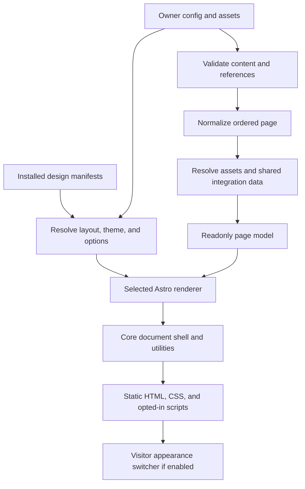
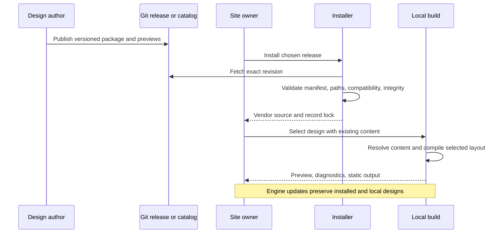

# Portable layouts and shareable designs

## 🎯 Problem

LibCard should support both today's compact link card and the richer monochrome
personal home explored in [0014](./0014_[_]_A_QUIETER_PERSONAL_HOME_INSPIRED_BY_KAMRAN_FYI.md).
An owner should be able to switch between them without rewriting their content.
Other people should be able to create, publish, and adopt entirely different
compositions using that same config contract.

This architecture was researched and implemented on 2026-10-19. All three phases
are complete: portable built-in layouts, the versioned authoring API, and shareable
packages with installation, updates, previews, and a discovery catalog. The
maintained contract and commands are in [DESIGNS.md](../DESIGNS.md). Historical
illustrations below describe the design rationale; the guide documents the final
manifest, including its explicit file inventory and required utilities slot.
It extends 0014's visual direction and supersedes its illustrative section API
where the examples differ. The implementation opts the owner config into Personal
home and adds local artwork; it has not been published to the live site.

## Executive summary

**Separate layouts from appearance; bundle them as shareable designs.**

| Concept | Responsibility | Proposed owner setting |
| --- | --- | --- |
| Content | Identity, destinations, descriptions, media, groups, contact and integration choices | Existing config, extended with semantic fields |
| Layout | Composition, width, responsive behavior, hierarchy, component treatments | `layout: editorial` |
| Theme | Colors, typography tokens, radii, existing appearance effects | Existing `theme: frost` |
| Design | A named combination of layout, theme, and presentation defaults | `design: personal-home` |

Most owners would pick **one design**. Advanced owners could override its layout
or theme. Authors could share a YAML preset, or supply an Astro renderer for a
new composition. Keep the existing meaning of `theme:` so old configs, community
theme files, and the browser's theme switcher keep working.

The first release should prove the contract with **Classic** and **Personal
home**, not ship a marketplace or a visual page builder. The essential investment
is a portable content model and a supported renderer boundary. Distribution can
follow without changing that model.

## Current state in the repository

These are observations from the current implementation, rather than proposed APIs.

| Area | Evidence | Architectural implication |
| --- | --- | --- |
| Home composition | [`src/pages/index.astro`](../../src/pages/index.astro) renders Profile → SocialRow → links → blocks → CardReveal | A theme cannot currently change structure |
| Page shell | [`Layout.astro`](../../src/layouts/Layout.astro) also owns width, centered alignment, gaps, theme effects, footer, analytics, and card mode | Extract visual composition without duplicating document and integration behavior |
| Config | [`schema.mjs`](../../src/lib/schema.mjs) has strict nested objects; links have no content IDs, descriptions, or preview images | New content fields require explicit schema support; an arbitrary YAML key is not a feature |
| Existing blocks | [`Block.astro`](../../src/components/Block.astro) dispatches text, gallery, FAQ, RSS, GitHub, embeds, forms, and other variants | Reuse this vocabulary and provide a standard fallback renderer |
| Themes | [`theme-schema.mjs`](../../src/lib/theme-schema.mjs) validates data-only YAML and emits project-controlled CSS | Preserve this useful boundary; executable layouts are a different extension type |
| Live switching | [`themes.ts`](../../src/lib/themes.ts), ThemeBoot, and ThemeSwitcher select token sets on the existing DOM | Switching whole layouts would require a different preview mechanism |
| Integration traversal | [`config.ts`](../../src/lib/config.ts) checks `cfg.blocks` for live embeds; schema refinement also scans root blocks for Feedme rules | Sections require shared traversal, otherwise disclosures or validation can miss content |
| CSS assumptions | [`effects.css`](../../src/styles/effects.css) globally targets `.bg-surface` and `.bg-accent`; [`global.css`](../../src/styles/global.css) assigns status hues | New layouts need scoped style hooks; a neutral palette alone does not make every element monochrome |
| Engine updates | [`update.mjs`](../../scripts/update.mjs) replaces upstream-matching `src/**`, scripts, root package manifest/lock, and theme YAML | Custom renderers need protected storage; adding a dependency to root package.json is insufficient |
| Theme ownership | Both update scripts overwrite matching upstream theme filenames | Current preservation is based on filename absence, not an ownership registry; avoid new collisions |
| Community previews | [`theme-preview.yml`](../../.github/workflows/theme-preview.yml) uses a privileged workflow that overlays theme data onto trusted code | Do not extend this path to execute contributed Astro components |

The project uses Astro 5, Tailwind 4, YAML, and Zod. Its generated schemas and
theme assets already offer a foundation for editor completion and build-time
validation. The theme gallery and setup wizard currently teach `theme:` as an
appearance selection, so changing that meaning has a real migration cost.

Neither existing `paper` nor `mono` is the exact new direction: Paper is warm
and serif with a colored accent; Mono is monospace with strong borders. Add a
new monochrome appearance instead of changing either existing theme.

## External research

| Primary source | Observed pattern | Application to LibCard |
| --- | --- | --- |
| [Astro 5 layouts](https://v5.docs.astro.build/en/basics/layouts/) and [components](https://v5.docs.astro.build/en/basics/astro-components/) | Layouts are ordinary components; components accept props and slots and render HTML without a client runtime by default | Use the existing framework for arbitrary compositions; no new template language or required React runtime |
| [Astro 5 package publishing](https://v5.docs.astro.build/en/reference/publish-to-npm/) | Astro source components and supported asset types can be distributed as packages without precompiling them | A LibCard renderer can be shared as source; npm is possible later, not a prerequisite |
| [Astro 5 imports](https://v5.docs.astro.build/en/guides/imports/#importmetaglob) | Glob import patterns must be static strings | Resolve configuration into a known build entry; do not treat a YAML path as a runtime module loader |
| [JSON Resume schema](https://jsonresume.org/schema) and [themes](https://jsonresume.org/themes) | A shared content schema supports community renderers and previews of the same resume under different themes | The valuable portable artifact is the owner's content, not a copy of a themed site |
| [WordPress style variations](https://developer.wordpress.org/themes/global-settings-and-styles/style-variations/) | One theme can offer multiple appearance variations | A coherent design can bundle preferred appearances while keeping their data separate |
| [Hugo theme components](https://gohugo.io/hugo-modules/theme-components/) | Theme composition has explicit precedence and project overrides | Define override rules early; avoid inheriting an open-ended template cascade for the first release |

The recommendation below is an inference from those patterns and LibCard's own
constraints. It does not propose adopting WordPress, Hugo, or their extension
systems. Astro references use the v5 documentation to match this repository.

## Key findings

### 1. Portability is a content contract, not just an import mechanism

Importing a new Astro file is relatively small work. Making that file useful with
someone else's profile, sparse links, long writing titles, galleries, tip actions,
and contact preferences is the larger job.

A layout must consume a **normalized page model**, not read the owner's YAML or
import private engine components by relative path. Content enrichment should run
once through shared services, so every renderer receives the same resolved URLs,
status labels, GitHub metadata, and opted-in Feedme actions.

### 2. An unrestricted visual layout needs a code extension point

YAML can select, group, order, and configure existing components. Encoding arbitrary
HTML, responsive grids, interactions, and styling into YAML would create a second
programming language. Offer a small declarative preset format and an Astro escape
hatch instead.

Here, “any layout” means a custom composition for the shared personal-site content:
an editorial page, sidebar, project grid, directory, resume-like presentation, or
minimal card. A new route system, CMS, authentication layer, or arbitrary backend
is beyond the initial layout contract.

### 3. Appearance changes and structural changes have different lifecycles

The existing visitor switcher can continue swapping CSS token sets instantly.
An owner changes a layout or design at build time. A future gallery can preview
separately rendered variants of the same sample content. It need not ship every
layout's markup and scripts to each visitor.

### 4. Richness should be optional; destinations should remain available

Screenshots, icons, and descriptions improve the new design, but a link with
only a label and URL must still work. A preset must never inject its author's
profile, coaching offer, analytics, payment destination, or personal links.
Sharing a design shares presentation; opting into content remains the owner's job.

## Options and tradeoffs

| Option | Strength | Cost / limitation | Decision |
| --- | --- | --- | --- |
| Put layout code directly into today's theme YAML system | One familiar name and selector | Changes the data-only contract; mixes runtime style switching with build-time rendering; complicates existing CI and migration | Avoid |
| Separate `layout:` and `theme:` only | Clear responsibilities, easy mixing, additive change | Owners must know which combinations reproduce a design; authors cannot share a complete selection conveniently | Good foundation |
| Separate contracts plus `design:` presets/packages | One-step adoption plus independent controls; old themes remain valid | One extra named concept and explicit resolution rules | **Recommended** |
| A universal YAML block/grid builder | Declarative composition without author code | Growing DSL, large test matrix, weak control over distinctive designs | Defer; not required for either target layout |
| Fork the entire Astro site per design | Unlimited freedom immediately | Content and engine diverge; adoption and updates become migrations | Useful for independent sites, poor LibCard interchange format |

Calling full packages “themes” in a future gallery is a product-language choice.
For the config/API, use distinct names now. Do not silently make an existing
`theme: frost` identifier capable of importing arbitrary source code.

## Recommendation: owner experience and resolution

### One setting for a complete design

```yaml
# Proposed shorthand. All profile/content/integration fields stay as they are.
design: personal-home
```

This built-in preset selects `layout: editorial`, a new `theme: monochrome`, and
editorial defaults such as compact spacing and grayscale preview treatment.
The corresponding classic preset selects `layout: classic` and `theme: default`.

Owners can also compose these explicitly:

```yaml
# Proposed composition: the personal-home structure with an existing appearance.
layout: editorial
theme: frost
```

Precedence is **explicit owner setting → selected design default → engine default**.
Changing only `design:` changes the whole look when no explicit overrides exist.
If a config already says `theme: frost`, adding `design: personal-home` preserves
Frost. Setup and preview tools should show this override and remove it only when
the owner chooses to use the complete preset.

Important implementation detail: today's schema eagerly defaults `theme` to
`default`. Preserve whether the input supplied a theme before resolving a design,
or every preset's appearance will be accidentally overridden. Prefer separate
input validation and resolved configuration stages, with defaults applied at the
appropriate stage. All consumers should read the resolved presentation.

Optional layout controls belong in a namespace, not mixed into content:

```yaml
design: personal-home
layoutOptions:
  editorial:
    density: compact
    mediaTone: grayscale
```

Validate options against a data-only schema declared by the installed layout.
Resolve options only for the selected layout, so another layout's saved settings
do not break switching. Treat unknown or uninstalled option namespaces as
diagnostics, not a reason to fetch code. Arrays replace rather than merge.

Do not let presets override content, section membership, integrations, site URL,
footer preferences, or contact-action opt-ins. They supply presentation defaults
only. A later per-section visual override can live under `layoutOptions`, but it
is unnecessary for the first two layouts.

### Extend the config with portable content

Retain canonical `links` and existing block variants. Add:

| Proposed field | Meaning |
| --- | --- |
| `profile.intro` | Optional short introduction using the existing safe Markdown renderer |
| `profileActions` | Explicit choices such as email, save-contact, and show-card |
| `links[].id` | Stable content identity; separate from any `feedme.id` |
| `links[].description` | Optional plain-text explanation |
| `links[].iconImage` | Optional explicit image path/URL for a project mark; existing `icon` remains the fallback |
| `links[].image` | Optional preview object with `src`, `alt`, `width`, and `height` |
| `sections` | An ordered union of link groups and existing block types |
| Link-group `purpose` | Optional semantic hint: `work`, `services`, `writing`, `experiments`, or `general` |

`purpose` is a hint, not a requirement to use certain cards. Its default is
`general`. A renderer must not infer meaning from English titles, known URLs, or
the maintainer's section IDs. The purpose vocabulary can grow compatibly while
every layout retains a generic link-group treatment.

This abbreviated illustrative content could drive either layout. The image paths
stand for owner-supplied assets; this is not a replacement for the current YAML.

```yaml
design: personal-home

profile:
  name: Chris
  avatar: /avatar.jpg
  intro: "I build open tools and explore how we work, learn, and relate."
profileActions: [email, save-contact, show-card]
contact:
  email: hello@example.com

links:
  - id: libcard
    label: LibCard
    url: https://github.com/crs48/LIBCard
    description: A personal home on the web that you own.
    icon: link
    iconImage: /projects/libcard-icon.svg
    image:
      src: /projects/libcard-preview.webp
      alt: A LibCard profile with projects and contact actions
      width: 1200
      height: 750
  - id: coaching
    label: Coaching
    url: https://example.com/coaching
    description: A place to slow down and work through what matters.
  - id: nervous-system
    label: Nervous system explorations
    url: https://example.com/nervous-system
    description: Notes and experiments in awareness and regulation.
  - id: essay
    label: An essay about building
    url: https://example.com/writing/building
    description: What a small experiment can teach us.
  - id: small-tool
    label: A small experiment
    url: https://example.com/experiments/tool
    status: experiment

sections:
  - type: links
    id: work
    title: Selected work
    purpose: work
    items: [libcard]
  - type: links
    id: together
    title: Work together
    purpose: services
    items: [coaching, nervous-system]
  - type: links
    id: writing
    title: Writing & exploring
    purpose: writing
    items: [essay]
  - type: links
    id: experiments
    title: Experiments
    purpose: experiments
    items: [small-tool]
  - type: text
    markdown: "A personal note can live between any two groups."

site:
  url: https://example.com
```

Changing `design: personal-home` to `design: classic` preserves the same content.
Classic presents grouped stacks with compact descriptions and optional thumbnails;
Editorial can use a lead screenshot, project cards, writing covers, coaching rows,
and a denser experiment list. With no new fields configured, Classic retains the
existing presentation. Missing media produces a complete text treatment, not an
empty placeholder or a network scrape.

Local assets should use the existing base-path helpers, so `/projects/foo.webp`
works under a GitHub Pages repository prefix. `iconImage` is displayed as an image,
not inlined arbitrary SVG markup. Remote media should be explicit and included
in network/disclosure accounting; no automatic favicon service or screenshot
service is required. Reserve image dimensions, lazy-load below-fold previews, and
make cropping a layout decision. Grayscale changes presentation, not source files.

### Ordering, legacy normalization, and content coverage

1. **No `sections`:** synthesize the existing links-then-blocks body, preserving
   order. IDs remain optional for legacy links; internal generated keys are not
   written back and are not public reference IDs.
2. **With `sections`:** use the explicit sequence. Root `blocks` may remain in
   their canonical location when placed exactly once by a `{ type: blocks }`
   section, or move those blocks inline. This implementation refinement preserves
   Feedme's root-block about import. Unplaced or multiply placed blocks fail
   validation; they are never silently discarded or appended.
3. **References:** require unique IDs for all links in sectioned mode, unique
   group IDs, and exactly one group reference per inventory link. Report unknown,
   duplicate, and unplaced IDs together with their YAML paths. A collapsed archive
   group still counts as a placement. `collapsed: true` is an optional shared
   disclosure preference with a visible label and count, not hidden content.
4. **Identity:** content IDs never replace Feedme target IDs. Repeated navigation
   shortcuts may point to a section, but repeating content placements is deferred
   until there is a clear need and an explicit schema for it.
5. **Reading order:** preserve owner section and item order in the meaningful DOM
   sequence. Layouts can place identity/actions in a sidebar or change grids,
   but should not create a different keyboard order with CSS reordering.
6. **Known blocks:** render natively or delegate to the standard block renderer.
   Unknown block types fail schema validation; required features unsupported by a
   package produce a compatibility error rather than disappearing.

This retains 0014's single-inventory rule while moving visual choices such as
`style: rows` out of section content. Supporting these additions in the current
engine is distinct from making older LibCard versions understand them. Upgrade
the engine before adding new fields; verify Feedme's raw-config importer with
enriched fixtures before claiming external compatibility.

## Recommendation: renderer architecture



### Public authoring surface

Create a versioned layout API, initially provided by engine-owned aliases, not a
separately published npm dependency. A normalized `PageModelV1` should contain
identity, resolved actions, ordered sections, media, social links, integration
results, and a mode indicating legacy or explicitly sectioned content. Include
source IDs for diagnostics and conformance checks. Keep normalization and
presentation resolution pure; isolate file reads and network enrichment.

Expose useful primitives such as Profile, ProfileActions, LinkMedia, LinkActions,
Section, Block, Socials, and CardReveal. Separate destination rendering from
metadata/action resolution so authors can create new link treatments without
reimplementing Feedme or GitHub behavior. Components should accept props, rather
than each independently loading global config.

Illustrative author code; `@libcard/layout` would be a new supported alias:

```astro
---
import { Profile, ProfileActions, Section } from "@libcard/layout";
import type { PageModelV1 } from "@libcard/layout";

interface Props {
  page: PageModelV1;
  options: { density: "compact" | "comfortable" };
}
const { page, options } = Astro.props;
---
<div class="notebook" data-density={options.density}>
  <header>
    <Profile profile={page.profile} />
    <ProfileActions actions={page.actions} />
  </header>
  <main id="main-content">
    {page.sections.map((section) => <Section section={section} />)}
  </main>
  <slot name="utilities" />
</div>
```

The layout can replace every visual treatment here, including Section. The shared
component is a complete fallback, not a mandatory aesthetic. The example omits
styling and some content for brevity; a conforming finished layout must also place
the configured social links, card controls, and all other enabled content.

The core document shell retains metadata, canonical URLs, base-path handling,
analytics wiring, theme initialization, and the business-card overlay. The
selected layout owns its width, composition, `<main>` landmark, and responsive
styles. Core-generated attribution/disclosure utilities are provided through a
required slot, which the layout places once. This removes the current centered
max-width wrapper without making every author rebuild the engine.

Keep `/card`, contact downloads, QR output, and `/themes` on dedicated core page
templates initially. Selecting an editorial home must not make the wallet/card
view use an editorial grid. Owners still control those affordances through config.

Coverage is a compatibility contract, not a sandbox guarantee. Manifest checks
can reject declared incompatibility and rendered fixture tests can detect omissions;
arbitrary trusted code can still ignore props or hide content. Do not promise that
a capability declaration mechanically proves a third-party layout is correct.

### Style contract

- Keep all existing theme tokens. Add optional tokens only when a demonstrated
  design needs them, with defaults preserving old themes. A `displayFont` token
  defaulting to `font` would support a serif introduction over sans-serif body text.
- Start the monochrome appearance with neutral colors and quiet borders. Its
  editorial renderer should use neutral status text and project marks; audit
  existing colored star/status treatments rather than assuming tokens cover them.
- Scope Classic's utility-class-based glass rules to Classic/shared components,
  or introduce explicit supported surface hooks. A custom layout's `.bg-surface`
  must not accidentally inherit a treatment designed for today's buttons.
- Prefer scoped CSS and semantic variables in community layouts. Do not require
  authors to depend on private Tailwind classes or generated engine selectors.
- Basic token rendering must work across the built-ins. Optional mesh, glass, and
  pattern effects need explicit compatibility handling. Show unsupported effects
  in preview; reject an explicitly requested incompatible combination. If a layout
  limits appearances, filter an implicit switcher pool and report explicit invalid
  selections rather than silently dropping them.

### Build and development entry selection

Resolve installed manifests as data, then generate a static import of the selected
layout before Astro compiles. Do not eagerly import every installed layout to
discover its metadata. Inactive packages should not run build-time code or add CSS
and scripts to the page. A generated module or equivalent Vite integration can
provide `@libcard/selected-layout`; prove the mechanism with a small build spike.

Run the same preparation for development and production. Config/manifest changes
must regenerate the entry or restart the dev server; stale generated registries
must not make a preview disagree with a build. Layout changes rebuild; the existing
visitor appearance switcher keeps its current token-based behavior.

## Recommendation: sharing, publishing, and upgrades

### Two authoring tiers, one design selection

**Preset author:** choose an installed layout, an appearance, and a few validated
options. Share a small manifest; no Astro expertise required. A data-only preset
may reference only an installed layout, never download one as a side effect.

**Layout author:** create an Astro entry and styles against the public page model,
plus a manifest, option schema, license, and preview. This is executable code at
build time and may include browser scripts. Describe those requirements honestly.
Validation of the manifest does not make arbitrary author code safe or private.

A proposed community package might look like:

```text
libcard-notebook/
  design.yaml
  Home.astro
  components/
  assets/                  # Design-owned decorative assets
  appearance.yaml          # Existing validated theme format
  options.schema.json
  preview.webp
  README.md
  LICENSE
```

```yaml
# Proposed design.yaml for a code-bearing layout package.
schemaVersion: 1
id: alex/notebook
name: Notebook
version: 1.0.0
author: Alex
license: MIT
compatibility:
  layoutApi: 1
  astro: ^5.13.0
layout:
  entry: ./Home.astro
  optionsSchema: ./options.schema.json
appearance:
  file: ./appearance.yaml
defaults:
  density: compact
capabilities:
  blockFallback: core
  clientJavaScript: false
  remoteAssets: false
```

For a preset-only package, replace `layout.entry` with `layout.use: editorial`;
these are mutually exclusive. `defaults` supplies options for that selected
layout only. `appearance.file` references packaged YAML; alternatively,
`appearance.use: monochrome` selects an installed theme. Require exactly one form.
The exact manifest should be finalized after both built-ins exercise it.

Use `author/name` IDs for community packages and reserve unqualified IDs for
built-ins. A bundled appearance receives a qualified registry identity; derive a
CSS-safe internal key rather than weakening the existing token validation or
colliding with `themes/mono.yaml`. Package authorship and appearance authorship
are separate metadata, and their source/credit links must not assume everything
lives in the upstream LibCard repository.

Bundle decorative media through Astro asset imports or the supported package-asset
helper. Resolve them under a package namespace and the site's base path; installation
must not copy decorative assets over the owner's `public/` files.

### Protect source ownership

```text
src/designs/builtin/        # Engine-owned Classic, Editorial, and presets
designs/local/             # Owner-authored source; preserved by engine update
designs/installed/         # Vendored, versioned community packages
designs.lock.yaml           # Source, exact revision, version, integrity
public/                    # Owner content assets; still sacred
```

The installer must scope every write to the chosen package directory and refuse
path escapes, symlinks escaping the package, or overwrites of an existing local
design. An engine update must not write into any of these protected design paths.
Community package upgrades are separate, explicit operations. Detect edited
vendored files and offer a local fork or a diff instead of overwriting them.

Start with self-contained Astro/CSS packages using the documented engine API and
Astro peer compatibility. Do not allow package-specific install hooks or new npm
dependencies in the first format. This deliberately postpones dependency merging:
the current updater replaces root package.json and pnpm-lock.yaml. A later npm
distribution path needs a preserved dependency/workspace contract first.

### Publication and adoption flow

1. Scaffold a design locally, starting from Classic or Editorial. Preview against
   the author's content and a standard generic fixture set.
2. Export only design-owned source, assets, options, metadata, and a sanitized
   sample. Never copy the owner's YAML, contact data, or `public/` wholesale.
3. Publish a Git repository release. Include desktop/mobile screenshots,
   compatibility, content coverage, script/network expectations, and licenses.
4. Optionally submit metadata to a discovery catalog. A catalog is an index, not
   a requirement for adoption or a source of code imported during every build.
5. An owner installs a pinned release, selects it, previews their own content,
   and deploys through the existing static-site workflow.

For illustration only, the eventual commands could be:

```sh
pnpm run design:add -- https://github.com/alex/libcard-notebook --ref=v1.0.0
# Set design: alex/notebook in libcard.config.yaml.
pnpm run design:check -- alex/notebook
pnpm dev
pnpm build
```

Installation records the resolved commit and content integrity, not just a movable
tag. Vendored files and the lock are committed, so later builds do not require the
author's repository to remain available. Verification uses the lock and local
files without executing package code; building or running a design check executes
the selected layout. Never run all discovered packages during a catalog scan.



Catalog previews for executable layouts require an unprivileged build with no
deployment secrets. A separate publishing step may consume validated image
artifacts; it must not execute contributed code. The existing privileged
data-only theme preview must remain separate. This is a concrete workflow boundary
in this repo, not an additional approval step for the present exploration.

## Implementation checklist

### Research completed

- [x] Read 0014 and inspect config, renderer, themes, CSS, integration traversal,
  update tooling, setup/gallery consumers, and theme CI boundaries.
- [x] Compare shared-schema renderers, Astro packaging, and appearance variations
  using primary documentation.
- [x] Define additive config semantics, a fallback strategy, and an upgrade-safe
  ownership model.

### Phase 1 — two built-in layouts and portable content

- [x] Extract Classic and the core document shell with legacy behavior preserved.
- [x] Introduce pure normalization/resolution and a shared block traversal helper.
- [x] Add stable IDs, descriptions, media, intro/actions, and semantic sections.
- [x] Test Feedme importer compatibility before shipping new public content fields.
- [x] Add Editorial and the new monochrome appearance using shared metadata/actions.
- [x] Implement `layout:`, `design:`, explicit precedence, and presentation-only defaults.
- [x] Add scoped styles and the smallest needed additive typography tokens.
- [x] Prove both layouts against the same rich config and sparse legacy fixtures.
- [x] Regenerate schemas through scripts; update README, setup guide/wizard/prompt,
  upgrade documentation, and changelog with the implementation.

### Phase 2 — supported local authorship

- [x] Stabilize PageModelV1 and a small documented layout/component API.
- [x] Add manifest and option-schema validation, local design storage, and clear
  compatibility diagnostics.
- [x] Generate the selected import consistently in dev/build and verify CSS/script
  isolation with an inactive-layout fixture.
- [x] Provide a scaffold, sanitized sample content, and a conformance command.
- [x] Explicitly protect custom designs and lockfiles in updater ownership rules.

### Phase 3 — distribution

- [x] Implement pinned installation/update, integrity checks, path containment,
  local-edit detection, and rollback by restoring source plus lock.
- [x] Add package previews and a lightweight catalog index with compatibility data.
- [x] Separate executable-layout preview builds from the privileged theme workflow.
- [x] Verify credits and source links for independently authored layout/appearance assets.
- [x] Document a release-and-adopt round trip using an independently authored design.

Defer nested layout inheritance, general custom block plugins, arbitrary package
dependencies, multi-page routing, an online editor, and live visitor layout
switching. None is necessary to deliver the current design or the first shareable
layout. Avoid committing to a public versioned SDK before two genuinely different
built-ins establish what it needs.

## Validation checklist

- [x] Omitted design/layout settings preserve existing Classic output and theme
  string/object behavior, including random pools, switcher, effects, and credits.
- [x] Test resolution with absent and explicit theme/layout settings; schema defaults
  cannot override a preset accidentally. Presets cannot alter owner content or opt-ins.
- [x] Render one rich fixture in Classic and Editorial. Assert the same required
  destinations, descriptions, section order, social links, contact actions, GitHub
  links, and Feedme targets remain available, including collapsed content.
- [x] Exercise missing optional media/intro, empty content, long names, long titles,
  broken remote assets, and a layout's standard fallback for each existing block.
- [x] Reject unknown, duplicated, and missing references; conflicting root blocks;
  unsupported API versions; invalid selected options; and incompatible appearances.
- [x] Traverse sectioned embeds/tip blocks for existing validation and disclosures.
  Verify external media are accounted for without new automatic fetch services.
- [x] Verify `/card`, contact.vcf, contact QR, page QR, landscape overlay, and
  persistent corner action with both home layouts and a non-root `site.base`.
- [x] Browser-check 320px, 390px, tablet, desktop, 200% zoom, keyboard navigation,
  heading order, alt text, focus indicators, reduced motion, and no-JS rendering.
- [x] Check real rendered contrast, image loading/layout shift, and shipped assets.
  Core layout selection should not add a mandatory client framework/runtime.
- [x] Confirm an inactive package does not execute or contribute layout assets;
  dev selection changes must agree with clean production builds.
- [x] Test engine/package updates with custom source and edited vendored files;
  content, locks, and local designs must survive. Offline builds work once ordinary
  dependencies and package files are present, apart from opted-in content fetches.
- [x] Test installation against conflicting IDs, changed tags, invalid hashes,
  traversal entries, unsafe symlinks, binary assets, and incompatible engine/API versions.
- [x] For implementation changes, run `pnpm test`, `pnpm typecheck`, and `pnpm build`,
  plus the targeted compatibility/browser fixtures introduced above.

### Phase 1 verification performed

- 205 unit tests pass; Astro typecheck reports zero errors, warnings, or hints.
- Production builds pass for the owner config, a rich fixture under both layouts,
  and the pre-change legacy config. All 12 themes pass enforced contrast checks.
- Playwright checks pass at 320, 390, 768, and 1280px with JavaScript disabled;
  archives, section embed disclosures, prefixed assets, vCard, and contact QR work.
- The owner page renders all 22 canonical links. Manual card navigation and the
  touch-device landscape overlay work; screenshots cover the new layout and the
  legacy presentation.
- Running the original and enriched YAML through Feedme's actual importer yields
  identical profile, about text, destination, and tip metadata results.

### Package/API verification performed

- 234 unit tests pass, including manifest compatibility, options, hashes, moved Git
  tags, binary files, ownership protection, edited-file refusal, and rollback.
- Classic, Editorial, and a separately packaged two-column notebook each pass rich,
  sparse, legacy, and all-17-block fixtures. Checks cover link/action/description
  preservation, exact ordering, headings, alt attributes, base paths, and utilities.
- Browser previews cover 320, 390, 768, 1280px and a 200%-equivalent viewport with
  JavaScript disabled, reduced motion, keyboard focus, broken remote images,
  collapsed content, both QR modes, vCard downloads, and manual/landscape cards.
- An isolated author repository and owner site verify export → tagged Git install
  → static build → explicit update → edited-source fork → offline rollback. The
  release includes a binary asset, a bundled appearance with separate credits,
  and imported media under a non-root site base.
- A valid inactive package throws if evaluated and carries a CSS sentinel; it
  neither executes nor contributes layout CSS. Dev switches from the installed
  layout to Classic and Editorial using the same preparation as clean builds.
- The installed/local/history paths and lockfile are excluded from engine writes;
  engine preflight validates the target API/versions and downloads before writing.
- The release export and catalog-entry commands were exercised on the separate
  example package. No external repository or public release was created.
- Theme contrast checks pass on enforced pairs; the existing muted-text advisories
  for Default and Mist are unchanged. Manual screenshot inspection complements
  automated checks; these checks are not a complete accessibility certification.

## References and next action

Repository anchors are linked alongside their findings above. Related design work:

- [0014: quieter personal home and monochrome design direction](./0014_[_]_A_QUIETER_PERSONAL_HOME_INSPIRED_BY_KAMRAN_FYI.md)
- [0002: theme gallery and live switching](./0002_[x]_THEME_MARKETPLACE_AND_LIVE_THEME_SWITCHING.md)
- [0006: rich content blocks](./0006_[_]_RICH_CONTENT_BLOCKS_AND_ZERO_JS_EMBEDS.md)
- [0008: shared config and the demo-site constraint](./0008_[x]_LANDING_PAGE_AND_VIRAL_LOOP.md)
- [Upgrading LibCard](../UPGRADING.md) and [Feedme contract](../FEEDME.md)

The implementation is complete. Use the maintained design guide for authoring and
publishing; the intentionally deferred features remain outside API 1.
